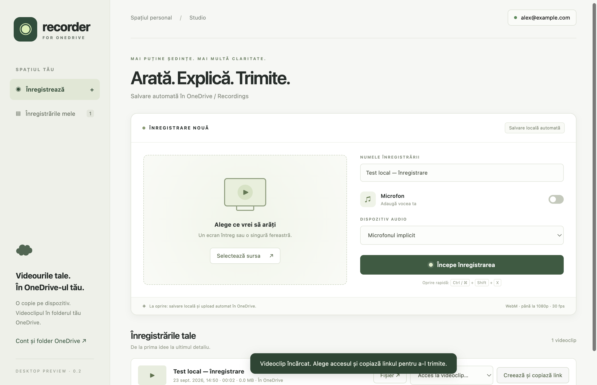
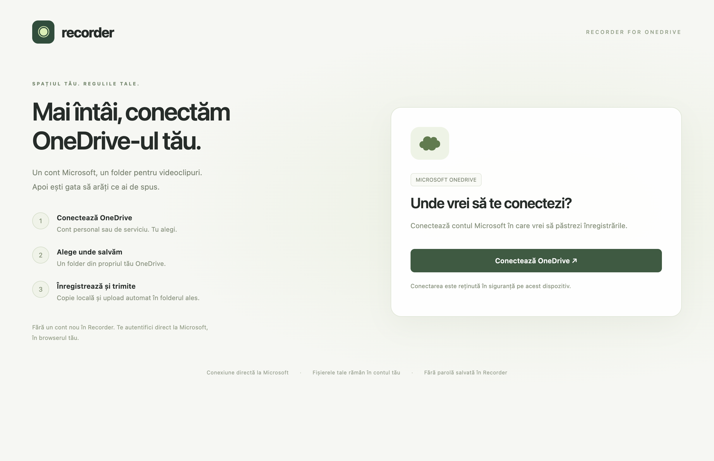

# OneDrive Recorder

**Loom's job, without the subscription.** Record your screen, get a link to send, and keep every file in storage you already own.

Screen recorders are a strange product: you record locally, they host the file, they hand you back a link — and they charge you per seat, per month, forever, mostly for the hosting. But you already have hosting. OneDrive syncs folders and makes share links all day. This app just connects the two ends that were always yours: it records, finalises a clean WebM straight into your synced folder, and lets OneDrive produce the link you send.

**What it saves you:** a per-seat recorder subscription for every person on the team — and the videos live somewhere you control instead of somewhere you rent. No account inside the app, no API keys, no Microsoft Graph integration. Nothing to authorise, nothing to revoke, no server of ours that can shut down and take your library with it.



## How it works

1. Install the official OneDrive client and sign in there — authentication never touches this app.
2. On first run, pick your synced folder. The app verifies it can write and delete a test file, so a wrong path fails immediately instead of after a recording.
3. Pick a screen or window, name the recording, record.
4. On stop, the WebM is finalised directly into the folder — filename cleaned for Windows/macOS/Linux, with a unique fragment so nothing is ever overwritten.
5. Hit **Share**: the app selects the file in Explorer/Finder, and OneDrive's own share flow produces the link and decides who can open it.

That one design decision — ride the official client instead of integrating with it — is why this can be free. No account system, no storage bill, no server to keep alive: nothing to charge for, and nothing to shut down later.



## Running it

Node.js 24 and npm:

```sh
npm ci
npm run check && npm test && npm run test:desktop
npm start
```

Portable Windows build (no installer needed):

```sh
npm run dist -- --win --x64 --publish never
```

macOS and Linux builds work via `npm run dist -- --mac` / `--linux --x64` on their native runners. Windows signing and macOS notarisation are not configured.

## Honest limits

- Recording format is WebM; OneDrive's in-browser player may not play it — download or convert if so.
- The app confirms the **local** save; it cannot confirm cloud sync or mint share links itself (that would need the Graph integration this design deliberately avoids).
- Pick the folder the OneDrive client actually syncs — any plain folder records fine but uploads nothing. Linux needs a third-party sync client.
- No webcam bubble, system audio, editing, transcription or auto-update. It records your screen into your own storage; that is the product.

Settings and library live in `%APPDATA%\OneDrive Recorder` and survive moving the executable. If you move the video folder, re-pick it; recordings reconnect by their unique filenames.

---

Built by [Gabriel Costache](https://needfortech.dev/work/onedrive-recorder) — the case study has the full design story. Romanian documentation: [README.ro.md](README.ro.md).
